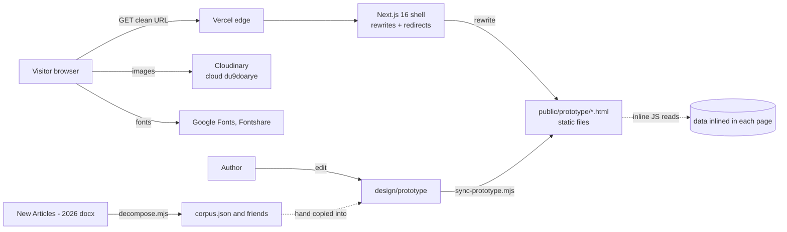

# Architecture

## 1. Context



There is one deployable and no server-side data path. The dotted lines are manual authoring steps, not runtime calls.

## 2. Stack

| Layer | Choice | Notes |
|---|---|---|
| Hosting | Vercel project `arctrips-destination-pages` (id `prj_D61THuJFryrU2CDGzl57B6Ohd7tN`) | Auto-deploys on push. Only the `*.vercel.app` domain is attached |
| Framework | Next.js 16.2.4, React 19.2.4, TypeScript 5 | A shell. Renders 404, `sitemap.xml`, `robots.txt`, the icon, and nothing else |
| Pages | Plain HTML + one shared stylesheet + small inline scripts | No bundler touches them |
| Styling | `design/prototype/_system.css` (about 31 KB) | Source of truth for the look. Tailwind v4 is wired only for the shell (`app/globals.css`) |
| Fonts | Inter (Google Fonts), Satoshi 700 (Fontshare, the `ARCTRIPS` wordmark only) | |
| Images | Cloudinary by URL, plus `public/prototype/media` | See [MEDIA.md](MEDIA.md) |
| Tests | Vitest (76), Playwright for the runtime gate | |
| CI | None | |

Runtime dependencies are `next`, `react`, `react-dom` only.

## 3. Request flow

```
GET /tofino/hiking
  1. next.config.ts redirects()   no match
  2. filesystem / public          no match
  3. next.config.ts rewrites()    /tofino/hiking -> /prototype/hiking-tofino.html
  4. response: the static file, URL unchanged
```

Rules that keep this working (details in [routing.md](routing.md)):

- Every asset in a page is root-absolute: `/prototype/_system.css`, `/prototype/media/...`. A relative path 404s on a two-segment URL.
- `scripts/lib/routes.mjs` is the only place routes are written. `next.config.ts`, `app/sitemap.ts`, both QA gates, `nav-rebuild.mjs`, `canonical-rebuild.mjs` and `.claude/routes.json` all read it.
- Legacy `/prototype/<file>.html` URLs 308 to the route.

## 4. Repository map

```
app/                         Next.js shell
  layout.tsx  globals.css    Inter font, brand tokens (@theme)
  not-found.tsx              plain 404, noindex
  sitemap.ts  robots.ts      generated from ROUTES
  icon.svg
design/prototype/            SOURCE for every page
  *.html                     47 routed pages + _map.html (internal, noindex)
  _system.css                design system
  _nav.js                    place-bar scroll spy
  brand/                     logo SVGs
  media/                     274 MB of original images (not deployed)
  corpus.json climate.json best-months.json deep.json vancouver-island.json
public/
  prototype/                 DEPLOYED copy (what Vercel serves) + resized media/ (96 MB)
  ideation/nav/              five rejected nav mockups, still public
  brand/
design/concepts/, design/structure/, design/index.html   early concept work, not deployed
scripts/
  lib/routes.mjs routes.d.mts  URL map + SITE_ORIGIN, canonicalFor
  lib/routes.test.mjs          URL contract tests
  lib/decompose.mjs clean.mjs docx.mjs   docx classifier and cleaners (+ tests)
  sync-prototype.mjs           design -> public
  nav-rebuild.mjs              regenerates the nav in every page
  canonical-rebuild.mjs        writes canonical tags
  qa-prototype.mjs             static gate (links, anchors, images)
  qa-runtime.mjs               Chromium gate over all routes
  strip-echo-labels.mjs        one-off copy cleanup, re-runnable
  analyze-corpus.mjs propose-map.mjs   inspect docx structure
  serve-design.mjs             static server for design/ (npm run concepts)
  qa.mjs                       obsolete, written for the earlier app
docs/                        this documentation, plus working notes (qa/, ideation/, superpowers/)
New Articles - 2026/         source .docx guides, gitignored, read-only
supabase/                    empty
```

## 5. Authoring and build pipeline

1. Edit a page in `design/prototype/`.
2. If navigation changed: `node scripts/nav-rebuild.mjs`. If the route map changed: `node scripts/canonical-rebuild.mjs`.
3. `node scripts/sync-prototype.mjs` copies code (not `media/`) to `public/prototype/` and fails if a page exists in only one tree, or if a deployed page references an image the deployed tree lacks.
4. Gates: `qa-prototype.mjs`, `npm test`, `npm run build`, `qa-runtime.mjs`.
5. Push; Vercel builds and deploys.

Why two trees: `media/` is 274 MB of originals; only resized copies ship (96 MB). The deployed copy once drifted a day behind and every Ucluelet link 404'd on the live site while the local copy passed, so the gates run against `public/`.

## 6. Content pipeline

```
New Articles - 2026/*.docx
   -> scripts/lib/docx.mjs        unzip, ordered {style, text, imageRef} blocks
   -> scripts/lib/decompose.mjs   category intro + N places + place-tagged photos + FAQs
   -> scripts/lib/clean.mjs       strip spacer headings, bare iStock URLs, flattened table headers
   -> corpus.json / deep.json / vancouver-island.json    (design/prototype and public/prototype)
   -> hand copy into page markup and inline data blobs
```

A doc is not an article: `Tofino - Beaches.docx` is the Beaches category page. H1 is the category, H2s are sections, each H3 under a place-listing H2 is one place. `placeHeadings` is an explicit per-doc whitelist of which H2s yield places; it must be read from the doc (`scripts/analyze-corpus.mjs`, `propose-map.mjs`), never guessed, or the FAQ H3s become places titled "Can you swim in Tofino?".

Broken link in this chain: the driver that wrote the output (`ingest-articles.mjs`, which targeted Supabase) was deleted on 2026-08-12. The classifier and its 69 tests remain. **There is no script that turns the JSON into pages**, so page content is hand-maintained. Writing that script, or replacing it with the backend, is the central engineering task.

Coverage: Tofino and Ucluelet are decomposed and designed. 24 other towns are in `deep.json` (1,075 places) and exist as simpler pages. 73 `.docx` files are on disk.

## 7. Options for the backend's relationship to the pages

The backend developer chooses; the constraint is that every URL in `ROUTES` keeps resolving and keeps its canonical.

| Option | What changes | Cost | Keeps |
|---|---|---|---|
| A. Sidecar API | Pages stay static. A new service (for example Next route handlers under `app/api/`, or Supabase edge functions) provides subscriptions, uploads, admin. Pages call it with `fetch` | Lowest. Only the three forms change | All 47 pages and URLs untouched |
| B. Build-time render | Content store feeds a generator that writes `design/prototype/*.html` (or replaces them with Next routes using `generateStaticParams`), triggered by a Vercel deploy hook on publish | Medium. Needs the missing JSON-to-page generator | Static speed and SEO |
| C. Dynamic render | Pages become Next server components reading the store | Highest. Rewrites 47 hand pages | Needs care to keep the same markup, the design system and the QA gates |

Recommended sequence: A first (implements the prototype's email forms, adds uploads), then B for content. `app/api/` does not exist yet; a Next route handler is the lowest-friction place for A because the project already deploys on Vercel and the host already has the project, env and domain.

## 8. Configuration and secrets

| Variable | Used by | Needed for the site? |
|---|---|---|
| `NEXT_PUBLIC_CLOUDINARY_CLOUD_NAME` | `du9doarye`, public | No (URLs are written into pages) |
| `CLOUDINARY_API_KEY`, `CLOUDINARY_API_SECRET` | nothing in this repo reads them today (the upload tooling that used them was deleted with the old app) | **Yes for the backend's signed uploads.** Server only |
| `NEXT_PUBLIC_SUPABASE_URL`, `NEXT_PUBLIC_SUPABASE_ANON_KEY`, `SUPABASE_SERVICE_ROLE_KEY` | nothing here since 2026-08-12 | The shared instance also serves Website-Builder; do not repurpose it without the owner |

`.env*` is gitignored; `.env.example` documents the keys (it still labels Supabase as the content source, which is out of date). The deployed site has no secrets. Add backend secrets in Vercel project settings, never in the repo.

## 9. Third parties

Cloudinary (images), Google Fonts and Fontshare (fonts), Vercel (hosting). The pages make no analytics, tracking or ad requests.

## 10. Security notes

No authentication surface exists. When one is added: the three forms need rate limiting and bot protection, double opt-in so a third party cannot subscribe someone else, and an upload endpoint that never exposes `CLOUDINARY_API_SECRET` to the browser (signed uploads only). Vercel Deployment Protection must stay on "Preview deployments only"; "All deployments" puts a login in front of production and webhooks.
